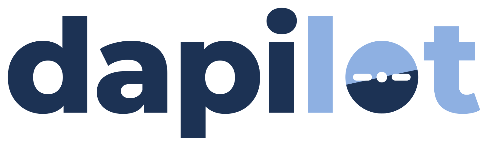
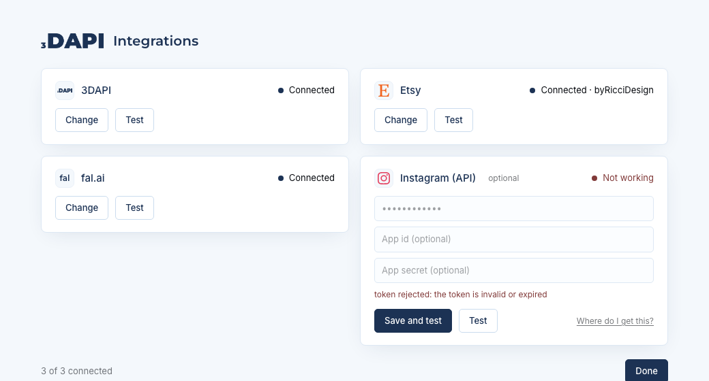

<p align="center">
  
</p>

<p align="center">
  <!-- TAGLINE: one line, yours to write -->
  <em>We know you like being lightning fast. We'll make you faster.</em>
</p>

<p align="center">
  <a href="https://github.com/3DAPI-Inc/dapilot/actions/workflows/plugin.yml"></a>
  
  
  <a href="LICENSE"></a>
</p>

<p align="center">
  <a href="https://discord.gg/AySP26jRM"></a>
  <a href="https://www.youtube.com/channel/UCZ_d0Sm0ck-UEmQdq5wVKyg"></a>
  <a href="https://www.linkedin.com/company/3dapi"></a>
  <a href="https://www.instagram.com/3dapi_official/"></a>
</p>

<!-- ABOUT: this section is yours to write. The two paragraphs below are placeholders. -->

Give it a model file. It lists the model on Etsy: analysed, quoted, photographed,
priced against the listings it competes with, written up, published, posted.
A person approves the price. The agent does the rest.

It is a Claude Code plugin: skills that decide, scripts that do, and one
local page where a seller connects the accounts the shop runs on.

## How it works

Every model goes through the same stages, in order, cheap before expensive.
Nothing paid runs for a model that cannot sell, and nothing after the price
runs until a person approves it.

| Stage | What happens |
|---|---|
| analyze | geometry: parts, size, watertightness |
| quote | 3DAPI slices and prices the file |
| preview | an 8-frame draft turntable |
| research | the Etsy listings it competes with, and the market band |
| price | a proposal above break-even, from the band and the quote |
| **approve** | **a person says yes, or names a price** |
| design | product name, studio stills, lifestyle photos, a clip |
| copy | title, description, tags, social captions |
| publish | the Etsy listing goes live; the posts go out |

## Install

Two ways in, same plugin.

**From Claude Desktop.** Customize, then Plugins, then add the marketplace
`3DAPI-Inc/dapilot` and install `dapilot`. Then, in Claude Code or the
desktop app's Code tab:

```
/dapilot:quickstart
```

**From this repository.**

```bash
git clone https://github.com/3DAPI-Inc/dapilot.git
cd dapilot
claude --plugin-dir plugins/dapilot
```

then `/dapilot:quickstart` in that session. The clone also carries the
console, the job server and the development scripts.

## First run

`/dapilot:quickstart` sets the computer up, checks that the required accounts
are connected, and tells you what is missing. `/dapilot:config` opens the
Integrations page, where the accounts are connected: every value is saved on
your computer only and checked with its platform, and nothing you type there
reaches the model.

<p align="center">
  
</p>

With everything connected, `/dapilot:quickstart <model file>` starts the run.
It stops at the price for your approval.

## What you need

- Claude Code, or the Claude desktop app, on macOS, Linux or Windows
- Python 3.10 to 3.13. Quickstart installs the packages, Blender, Chrome and
  ffmpeg where it can, and tells you where it cannot
- a 3DAPI account and API key, an Etsy shop with a seller app, a fal.ai key
- for the social posts, the accounts you want to post to

## Documentation

- [plugins/dapilot/README.md](plugins/dapilot/README.md): the plugin, its
  skills and scripts, the environment
- [docs/quickstart.md](docs/quickstart.md): setting a machine up by hand
- [docs/agents.md](docs/agents.md): how the agents are organised and what
  each may do
- [docs/skills.md](docs/skills.md): how a skill is written and judged
- [docs/market-research.md](docs/market-research.md): how a price is decided
- [docs/changelog.md](docs/changelog.md): what changed, when, and why

## Contributing and security

See [CONTRIBUTING.md](CONTRIBUTING.md) for how the code is laid out and what a
change needs. Credentials never go into the repository, the plugin or a
conversation; [SECURITY.md](SECURITY.md) says how they are handled and how to
report a problem.

## Community

Questions, show and tell, and what the shop is printing:
[Discord](https://discord.gg/AySP26jRM) ·
[YouTube](https://www.youtube.com/channel/UCZ_d0Sm0ck-UEmQdq5wVKyg) ·
[LinkedIn](https://www.linkedin.com/company/3dapi) ·
[Instagram](https://www.instagram.com/3dapi_official/)

## License

[MIT](LICENSE). Copyright 3DAPI Inc.
